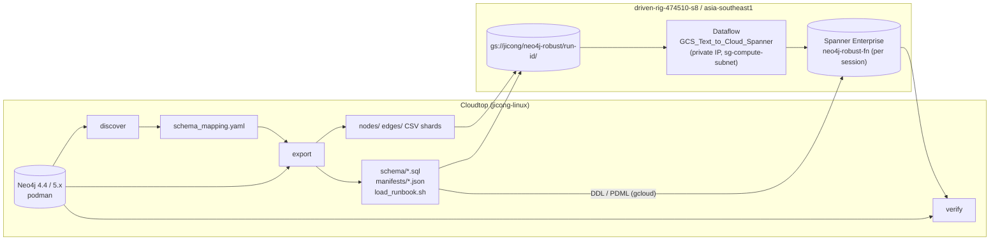
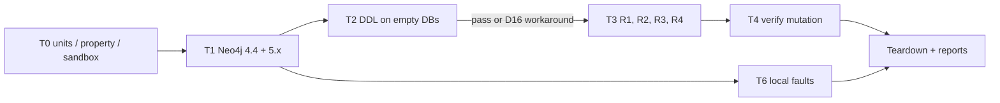

# Robustness Test Plan — `neo4j-spanner-export`

| Field | Value |
| :--- | :--- |
| Status | **DRAFT v2 — revised after the `/grill-me` review (§0)** |
| Author | jicong (drafted with Jetski) |
| Date | 2026-11-19 |
| Tool version under test | `neo4j-spanner-export 0.1.0` (`src/neo4j_spanner_export/`) |
| Target GCP project | `driven-rig-474510-s8` (region `asia-southeast1`) |
| Effort type | **Find & report**: confirm or refute hypotheses and log defects. Fixes come later. |

---

## 0. Decision log (from review)

| # | Decision | Effect on the plan |
| :--- | :--- | :--- |
| D1 | Goal: **find & report**, no fixes in this effort | Exit criteria = every hypothesis classified with evidence (§10) |
| D2 | Defects go in a **markdown log** at `tests/robustness/reports/<run-id>/defects.md` | One entry per confirmed hypothesis, with repro and evidence |
| D3 | GCS: **prefix in existing `gs://jicong`** (`gs://jicong/neo4j-robust/<run-id>/`); Spanner: **dedicated instance** | No new bucket. `gs://jicong` is in asia-southeast1 with UBLA, PAP enforced, and 7-day soft delete |
| D4 | Spanner instance is **created at session start and deleted at session end** | pytest session fixture (§8, §9) |
| D5 | **Scale tier (T5) out of scope** | G7/G8 and J-* removed; H20 covered by a cheap 60k-row variant (H-07) |
| D6 | Neo4j: **4.4 + 5.x Community only** (what README.md claims) | No Enterprise or 2025.x. `NODE_KEY` covered only at unit level; H28 out of scope |
| D7 | **Default compute SA only**; record its roles as an observation | G-08 and L-06 removed |
| D8 | Golden oracle: **hand-written for G2/G4/G6**, independent converter in the harness for the others | §4.2 |
| D9 | Correctness rule: **lossless by default** — any silent value change is a defect unless README.md documents it | §4.3 |
| D10 | E2E batching: **3 merged T3 runs** + 1 small add-on run for known-fragile values | §6.1 |
| D11 | Fault injection: **local only** | K-04, K-06, K-08, K-09, K-11 removed; H16 (GCS part) and H21 checked by static review |
| D12 | Verify mutation tests (T4): **full set**, including H-07 at 60k rows | §7-H |
| D13 | Tests are an **automated pytest suite** with tier markers; plain `pytest` stays offline and free | §8 |
| D14 | **Automatic teardown**, only for resources provably created by the session (label + run-id); `--rb-keep` skips it | §9.3 |
| D15 | Injection tests use a **stubbed-gcloud sandbox** and a harmless payload; the real runbook never runs with a payload | L-02..L-04 |
| D16 | Blocking defects: log them, then continue with a **user-level workaround through the tool's own inputs**. Never patch the source or hand-edit artifacts | §4.3 |
| D17 | Done = all in-scope tests run, every hypothesis Confirmed / Refuted / Not testable, GCP torn down | §10 |

---

## 1. Purpose and scope

The existing tests (`tests/test_core.py`, `tests/test_integration_neo4j.py`) cover the happy path well. This plan tests how **robust** the tool is:

1. **Fidelity:** Does every Neo4j value come out exactly (or as documented) in Spanner Graph, including adversarial values?
2. **Fail-fast correctness:** When the input is unsupported or ambiguous, does the tool stop *before* the Spanner load with an actionable error, instead of producing broken DDL/CSV or silently losing data?
3. **Generated-artifact validity:** Is every DDL/PDML/manifest/runbook file the tool emits accepted by real Spanner Enterprise and Dataflow?
4. **Verifier trustworthiness:** Does `verify` detect corruption? Does it raise false alarms?
5. **Operational resilience (local):** Neo4j faults, process kills, stale output, and re-runs.

**In scope:** `discover`, `export`, generated artifacts, the Dataflow `GCS_Text_to_Cloud_Spanner` load path, and `verify`, on Neo4j **4.4 LTS and 5.x Community**.

**Out of scope (this effort):** scale/performance; Neo4j Enterprise (`NODE_KEY` integration, multi-db) and 2025.x; least-privilege IAM; GCP-side fault injection (runbook re-run/resume, stale GCS prefix, Spanner throttling); concurrent writes during export; fixing defects; online/CDC migration; Aura and Fabric; PostgreSQL-dialect Spanner.

---

## 2. System under test (summary)



Load stages run by `load_runbook.sh`: 01 create tables → upload → Dataflow nodes → Dataflow edges → 02 array add/backfill/drop → (03 unescape, optional) → 04 FKs + reverse indexes → 05 `CREATE OR REPLACE PROPERTY GRAPH`.

---

## 3. Test environment (uses existing GCP environment)

### 3.1 Existing resources reused

| Resource | Value (discovered 2026-11-19) | Use |
| :--- | :--- | :--- |
| Project | `driven-rig-474510-s8` (number `379924935547`) | All GCP tests |
| Account | `cloud-admin@jicong.altostrat.com` | gcloud + `verify` (ADC) |
| Region | `asia-southeast1` (`regional-asia-southeast1` config available) | Spanner, Dataflow |
| Bucket | `gs://jicong` (ASIA-SOUTHEAST1, UBLA, PAP enforced, 7-day soft delete, no lifecycle rule) | Test data under `neo4j-robust/<run-id>/` **only** |
| VPC / subnet | `demo-vpc` / `sg-compute-subnet` (10.0.1.0/24, Private Google Access on) | Dataflow workers |
| Org policy | `constraints/compute.vmExternalIpAccess` enforced (job `2026-11-18_16_20_36-…` failed on it) | `DATAFLOW_DISABLE_PUBLIC_IPS=true` is mandatory |
| Dataflow SA | `379924935547-compute@developer.gserviceaccount.com` (succeeded on job `2026-11-18_16_38_52-…`) | Worker identity; reaches `gs://jicong` via legacy project bindings |
| Dataflow staging | `gs://dataflow-staging-asia-southeast1-379924935547` | Template temp |
| Enabled APIs | spanner, dataflow, storage, compute, logging, monitoring | — |
| Local | `podman`, `.venv` | Neo4j containers, tool |

### 3.2 Per-session resources

| Resource | Name | Spec | Lifecycle |
| :--- | :--- | :--- | :--- |
| Spanner instance | `neo4j-robust-fn` | `regional-asia-southeast1`, **ENTERPRISE**, 100 PU, label `purpose=neo4j-robustness-test`, `rb-run-id=<run-id>` | Created at pytest session start, deleted at session end (D4, D14) |
| Spanner databases | `rb_<fixture>_<nn>` | GoogleSQL | Deleted along with the instance |
| GCS prefix | `gs://jicong/neo4j-robust/<run-id>/` | — | Removed at session end (still recoverable for 7 days via soft delete) |
| Neo4j containers | `neo4j-v5` (7687), `neo4j-v44` (7688) | Community | Started by `conftest.py` if absent; left running unless `--rb-stop-neo4j` |

`<run-id>` = `rb-YYYYMMDD-HHMMSS-<4 hex>`; it's written to `tests/robustness/reports/<run-id>/session.json`.

### 3.3 Pre-flight (read-only, run by the session fixture)

```bash
export PROJECT_ID=driven-rig-474510-s8 REGION=asia-southeast1
export DATAFLOW_REGION=asia-southeast1
export DATAFLOW_SUBNETWORK=regions/asia-southeast1/subnetworks/sg-compute-subnet
export DATAFLOW_DISABLE_PUBLIC_IPS=true
export NEO4J_PASSWORD=testpassword123
DF_SA=379924935547-compute@developer.gserviceaccount.com

gcloud config get-value project                                  # == driven-rig-474510-s8
gcloud compute networks subnets describe sg-compute-subnet --region=$REGION \
  --project=$PROJECT_ID --format="value(privateIpGoogleAccess)"   # True
gcloud projects get-iam-policy $PROJECT_ID --flatten="bindings[].members" \
  --filter="bindings.members:serviceAccount:$DF_SA" --format="value(bindings.role)"  # recorded (D7)
gcloud spanner instances describe neo4j-robust-fn --project=$PROJECT_ID 2>/dev/null \
  && echo "ABORT: instance already exists (not ours)"            # never adopt a foreign instance
```

Equivalent manual commands for what the session fixture creates:

```bash
gcloud spanner instances create neo4j-robust-fn --project=$PROJECT_ID \
  --config=regional-asia-southeast1 --edition=ENTERPRISE --processing-units=100 \
  --description="neo4j robustness test (ephemeral)"
gcloud spanner instances update neo4j-robust-fn --project=$PROJECT_ID \
  --update-labels=purpose=neo4j-robustness-test,rb-run-id=<run-id>
podman run -d --name neo4j-v5  -p 7687:7687 -e NEO4J_AUTH=neo4j/$NEO4J_PASSWORD docker.io/library/neo4j:5
podman run -d --name neo4j-v44 -p 7688:7687 -e NEO4J_AUTH=neo4j/$NEO4J_PASSWORD docker.io/library/neo4j:4.4
```

---

## 4. Test strategy

### 4.1 Test tiers

| Tier | Name | Where it runs | GCP cost | Typical runtime |
| :--- | :--- | :--- | :--- | :--- |
| **T0** | Unit + property-based (Hypothesis) | Local, offline | none | < 2 min |
| **T1** | Neo4j integration (discover/export) | podman 4.4 + 5.x | none | ~10 min |
| **T2** | **DDL validity on empty Spanner DBs** (`01`, `02_add`, `04`, `05`), no Dataflow | `neo4j-robust-fn` | very low | ~1–2 min per fixture |
| **T3** | Full E2E: runbook → `verify` → independent oracle | GCP | medium | ~20–25 min per run × 4 runs |
| **T4** | Verify mutation testing on the T3 databases | GCP | low | ~5 min per run |
| **T6** | Local fault injection & recovery | Local | none | ~30 min |

(T5 scale is out of scope, per D5.)

### 4.2 Key strategy decisions

1. **`verify` is not an independent oracle (H01).** It sends Neo4j values through the same `serializer.coerce_value()` the exporter uses. T3 therefore adds independent oracles (D8):
   - **Hand-written golden YAML** (`expected_spanner.yaml`: table → PK → column → literal expected Spanner value) for G2-values, G4-types, and G6-pk. Target: ~300 assertions.
   - An **independent converter** (`harness/oracle.py`) for G1, G5, and G9. It encodes the README's documented conversion rules and **must not import anything from `neo4j_spanner_export`** (enforced by a test that inspects the module's imports).
2. **Shift-left on DDL (T2).** Every fixture's DDL is applied to an empty DB before any Dataflow job runs.
3. **Fixture-driven.** Each fixture = seed + expected discovery outcome (mapping snapshot **or** error regex) + golden values (where applicable).
4. **Hypothesis-driven.** Every suspected defect in §5 is linked to tests and ends up Confirmed / Refuted / Not testable.
5. **Determinism.** The same input must produce byte-identical mapping, DDL, and manifests (and CSV after sorting) across re-runs and across 4.4/5.x.

### 4.3 Correctness rules

- **Lossless by default (D9):** a silent change to any value or semantics (precision, time zone, type, label visibility, NULL vs `""`) is a **defect** unless README.md documents it. Documented conversions (e.g. `TIME`/`DURATION` → `STRING`, `POINT`/`MAP`/mixed lists → `JSON`, multi-label → `secondary_labels`) are fine. If the README is ambiguous, log it as a defect with the label `doc-gap`.
- **PASS (data):** zero diffs between Neo4j, the oracle, and Spanner, **and** `verify` exits 0.
- **PASS (negative):** the tool exits non-zero **before any Spanner write**, with an error naming the offending label/property/value and the YAML fix. A raw traceback = **FAIL (UX)**.
- **Blocking defects (D16):** log the defect, then continue with the smallest workaround **a real user could apply through the tool's inputs** (`column_renames`, `table_renames`, `override`, `label_priority`, a CLI flag, or removing the offending property from that fixture's seed). Record the workaround in the defect entry. Never patch `src/` or hand-edit generated artifacts.

### 4.4 Defect log format (D2)

`tests/robustness/reports/<run-id>/defects.md`, one entry per confirmed hypothesis or new finding:

```markdown
### DEF-007 — <title>   (Hypothesis: H09 · Severity: P0 · Status: Confirmed)
- Tests: F-06, F-07
- Neo4j: 5.x / 4.4 · Fixture: g5_topology
- Repro: <commands / minimal seed>
- Evidence: <Spanner error text, DDL statement, Dataflow job id, verify_report.json excerpt>
- Expected vs actual: ...
- Workaround used to continue: <input-level workaround or "none">
```

`reports/<run-id>/summary.md` holds the hypothesis matrix (§5), with status and links to the DEF entries.

---

## 5. Hypotheses from code review

Priority: **P0** = silent data loss/corruption or a guaranteed load failure on realistic data; **P1** = load failure on plausible data or a misleading `verify` result; **P2** = edge case or UX. "Method" = how it will be classified.

| ID | Hypothesis | Code location | Pri | Tests / method |
| :--- | :--- | :--- | :--- | :--- |
| H01 | `verify` can't catch coercion bugs (shares `coerce_value()`) | `verify._normalize_neo4j_expected` | P0 | H-01..H-05, T3 oracle |
| H02 | `DateTime` ns truncated to µs (`to_native()`); `verify` compares only to ms, which hides it | `serializer.py` L167-168; `verify.py` L89/L121 | P0 | D-14, H-04 |
| H03 | INT64+FLOAT64 → FLOAT64 loses precision > 2^53; `verify` `isclose` hides it | `types.widen_types`; `verify._values_equal` | P0 | D-05, D-13, H-05 |
| H04 | Type overrides not validated: float→INT64 truncates, unknown string→BOOL `false`, invalid type strings reach DDL | `serializer.coerce_value`; `config` | P0 | A-08, D-10, D-11 |
| H05 | `pk_overrides` not checked for uniqueness or a legal PK type | `discovery._resolve_node_pk` | P0 | B-09, B-10 |
| H06 | Unique keys `1` and `"1"` widen to STRING → duplicate Spanner PK | `widen_types` + PK selection | P1 | B-11 |
| H07 | `NaN`/`Infinity` inside lists/maps → invalid JSON → load failure | `coerce_value` JSON branch | P1 | D-08 (add-on run) |
| H08 | Spanner Graph may reject one property name with different types across node labels | `_render_property_graph_sql` | P0 if confirmed | F-05 |
| H09 | `CAST(… AS STRING(MAX))` / `CAST(NULL AS STRING(MAX))` / `CAST(ARRAY AS STRING)` in shared edge labels may be invalid | `artifacts.py` L192-221 | P0 if confirmed | F-06, F-07 |
| H10 | Secondary labels aren't GQL labels → `MATCH (n:Promoted)` returns 0 | `_render_property_graph_sql` | P1 | F-09 |
| H11 | `f"fk_{table}_dst"[:128]` drops the hash suffix → FK/index name collision | `_render_constraints_indexes_sql` | P1 | C-07 |
| H12 | `dst_` + a 125–128-char column name exceeds 128 chars | `layout.get_edge_columns` | P2 | C-08 |
| H13 | `spanner_backtick()` doubles backticks; GoogleSQL uses backslash escapes | `naming.spanner_backtick` | P2 | C-09 |
| H14 | Delimiter/null string `~` breaks the `^~^` Dataflow parameter separator | `_render_load_runbook` | P2 | G-06 (sandbox) |
| H15 | `--gcs-prefix` / `--graph-name` unvalidated → shell / DDL injection | `_render_load_runbook`, `_render_property_graph_sql` | P1 (security) | L-03, L-04 (sandbox) |
| H16 | Stale shards (local dir, and GCS prefix) are loaded too; export never cleans; manifest glob `<table>_part_*.csv` | `writer.py`, `_build_manifest` | P1 | K-05 (local); **GCS part: static review** (D11) |
| H17 | A 0-row table writes no shard → manifest glob matches nothing → Dataflow behaviour unknown | `writer.close` | P2 | K-03 (local part: shard/manifest check); Dataflow behaviour **Not testable** in scope |
| H18 | `--sample-size` misses types → export crashes mid-stream with a partial bundle | `discovery`, `coerce_value` | P1 | A-06 |
| H19 | `verify` lookups with widened/overridden/TIMESTAMP/BYTES PKs → false `missing_in_neo4j` | `verify._sample_*` | P1 | H-06 |
| H20 | `verify` sampling only covers the first 50k rows (`LIMIT` with no randomisation) | `verify.py` L211/L296 | P2 | H-07 (60k-row table) |
| H21 | Runbook isn't idempotent (fails if DB exists, no resume) | `load_runbook.sh` | P1 | **Static review** of the generated runbook (D11) |
| H22 | Date/DateTime year < 1 or > 9999 crashes `to_native()` / rejected | `serializer` | P2 | D-15 |
| H23 | > 1024 columns per table not detected | `discovery` | P2 | F-04 (T2) |
| H24 | No driver timeout; a stalled Neo4j hangs export; failed thread doesn't cancel others | `exporter.export_graph` | P1 | K-01, K-02 |
| H25 | Empty DB → `NODE TABLES ()` invalid | `artifacts` | P2 | B-14 |
| H26 | Unknown YAML key → raw `TypeError` | `config.from_dict` | P2 | A-04 |
| H27 | Writes during export → dangling edges → late FK failure | process | P1 | **Out of scope** (README requires a quiesced DB; D11) |
| H28 | Neo4j 2025.x calendar version / Cypher 25 `id()` | `compat` | P1 | **Out of scope** (D6) |
| H29 | Multi-label overlap double-counts/drops rows across canonical tables | `discovery`/`exporter` | P0 | B-05, B-06 (property-based) |

---

## 6. Test fixtures

All fixtures live under `tests/robustness/fixtures/<name>/`: `seed.cypher` / `seed.py`, optional `input_mapping.yaml`, `expected_discovery.yaml` **or** `expected_error.txt`, and optional `expected_spanner.yaml`.

| Fixture | Purpose | Size | Oracle |
| :--- | :--- | :--- | :--- |
| **G0-empty** | Empty DB; constraints only; nodes but no edges | 0–10 | — (T1/T2) |
| **G1-baseline** | Existing `scripts/seed_synthetic_graph.py` | ~20 | independent converter |
| **G2-values** | Adversarial values (checklist below) | ~500 | **hand-written golden** |
| **G3-naming** | Reserved words, case collisions, unicode/backtick/space names, 128+ char names, long triplet keys | ~100 | — (T1/T2; expected errors) |
| **G4-types** | Type-conflict matrix per property | ~2,000 | **hand-written golden** |
| **G5-topology** | Self-loops, parallel edges, multi-label overlaps, one rel type across many triplets, super-node (10k out-edges), isolated nodes, cycles, **one 60,000-row node table** (H-07) | ~75,000 | independent converter |
| **G6-pk** | PK sources (single/composite uniqueness, uniqueness with NULLs, no constraint, overrides incl. invalid ones, mixed-type unique keys). `NODE_KEY` is unit-level only (D6) | ~500 | **hand-written golden** (valid subset) |
| **G9-random** | Hypothesis-generated small graphs | 10–200 each | invariants (T1); 2 fixed seeds in T3 |

**G2-values checklist:** `""`, `" "`, `"__NULL__"` (collision → T1 only), `"__NULL__ "`, a literal two-character `\n` vs a real LF, CRLF, a lone CR, a trailing backslash, `\\`, `\"`, a quote/delimiter at the start or end, tab, NUL, U+2028/2029, `\ufeff` at the start of a field, RTL, 4-byte emoji, a 1 MiB string, a 9.9 MiB string, a 10.1 MiB string (T1 only); INT64 min/max, `-0.0`, subnormals, max float, scalar `NaN`/`±Infinity`, `2^53+1`; bytes `\x00\xff` and empty bytes; `Date` 0001-01-01 and 9999-12-31; `DateTime` with ns, named zones across DST gap/overlap, `+14:00`/`-12:00`; `LocalDateTime`; `Time`/`LocalTime`; `Duration` (mixed, negative); `Point` 2D/3D Cartesian/WGS-84; lists: empty, singleton, 100k elements, `[1, 2.5]`, `[true]`, `[""]`, delimiter/quote inside list strings, lists of temporals/points. **Known-fragile values** (`NaN` inside lists, H07; year-0 dates, H22) are kept out of the merged run (§6.1).

### 6.1 End-to-end run batching (D10)

Each label set is distinct, so fixtures can share one Neo4j DB and one Spanner DB per run.

| T3 run | Neo4j content (5.x; 4.4 parity is checked in T1) | Spanner DB | Purpose |
| :--- | :--- | :--- | :--- |
| **R1** | G1-baseline | `rb_r1_01` | Regression anchor |
| **R2** | G2-values + G4-types + G6-pk (valid subset) | `rb_r2_01` | Value fidelity vs golden YAML |
| **R3** | G5-topology + G9 seeds #1, #2 | `rb_r3_01` | Topology, graph semantics, H-07 |
| **R4 (add-on)** | Known-fragile values only (`[NaN]`, `[Infinity]`, map with NaN, …) | `rb_r4_01` | Confirms H07 without blocking R2 |

Rules: T2 must pass for the run's content first (or a D16 workaround is applied); fixtures that are expected to fail-fast never go into T3.

---

## 7. Test catalog

Columns: **ID** | **Scenario** | **Expected** | **Tier** | **Pri** | **Hyp.** Removed items are kept as ~~strikethrough~~ with a reason, for traceability.

### A. CLI, configuration & input validation

| ID | Scenario | Expected | Tier | Pri | Hyp. |
| :--- | :--- | :--- | :--- | :--- | :--- |
| A-01 | Missing `NEO4J_PASSWORD` and `--password` | Clean message, exit ≠ 0 | T0 | P2 | |
| A-02 | Wrong password / unreachable URI / `neo4j+s://` against plaintext | Actionable error, no traceback, no partial files | T1 | P2 | |
| A-03 | `--database` that doesn't exist (Community: only `neo4j`/`system`) | Clear error | T1 | P2 | |
| A-04 | Hand-edited YAML: unknown key, missing field, wrong types, empty file | Validation error naming the key | T0 | P2 | H26 |
| A-05 | `--chunk-rows 0`, negative `--workers`, `--workers 64` | Clean error / clamps / works | T0/T1 | P2 | |
| A-06 | `discover --sample-size 10` → add a node with a new type → `export` | Fail-fast before writing, or documented; never a partial bundle | T1 | P1 | H18 |
| A-07 | Serializer option matrix: delimiter ∈ {`,`, `\|`, `\t`, `;`, `~`, `\x01`}, quote ∈ {`"`, `'`}, escape ∈ {`\`, `^`} | Illegal combinations rejected; legal ones generate a valid runbook (sandbox) | T0 | P1 | H14 |
| A-08 | `override:` valid (`STRING(MAX)`, `INT64`) and invalid (`VARCHAR`, `ARRAY<JSON>`, `int64`) | Invalid ones rejected at export, not at Spanner DDL | T0/T2 | P0 | H04 |
| A-09 | Re-discovery with `--input-mapping` keeps all user edits | Byte-identical mapping on the second run | T1 | P1 | |
| A-10 | `--default-timezone` invalid / `Asia/Singapore` with `LocalDateTime` | Clean error / correct UTC (golden, R2) | T0/T3 | P1 | |

### B. Discovery: labels, primary keys, triplets

| ID | Scenario | Expected | Tier | Pri | Hyp. |
| :--- | :--- | :--- | :--- | :--- | :--- |
| B-01 | Node with no labels | Fail-fast with count | T1 | P2 | |
| B-02 | Ambiguous multi-label (existing) + a 3-way overlap | Error lists every conflicting label set | T1 | P1 | |
| B-03 | Two constrained labels on one node | "multiple constrained labels" | T1 | P1 | |
| B-04 | `label_priority` with an unknown or duplicate label | Ignored or warned; no crash | T1 | P2 | |
| B-05 | **Property-based node partition:** Σ node-table rows == total nodes; each node in exactly one table | Holds for 500 random graphs (4.4 + 5.x) | T1 | P0 | H29 |
| B-06 | **Edge partition:** Σ edge-table rows == total relationships | Holds | T1 | P0 | H29 |
| B-07 | `NODE_KEY` preferred over uniqueness; shortest composite chosen deterministically | **Unit-level only** (mocked `ConstraintInfo` + fake driver); integration = Not testable (D6) | T0 | P1 | |
| B-08 | Uniqueness constraint with NULL/missing values | Falls back, with a warning | T1 | P1 | |
| B-09 | `pk_overrides` on a column with duplicates | Fail-fast at discover/export (expected); suspected late Dataflow failure — confirm in T1 (no check) and in T3 only if a cheap separate DB fits (otherwise classify from T1 + static review) | T1 | P0 | H05 |
| B-10 | `pk_overrides` resolving to `JSON` / `ARRAY` / `FLOAT64` / `TIMESTAMP` | `JSON`/`ARRAY` rejected; others work (T2 DDL; values in R2) | T1/T2/T3 | P0 | H05 |
| B-11 | Unique key values `1` and `"1"` (and `1` vs `1.0`) | Collision detected before load | T1 | P1 | H06 |
| B-12 | Constraint on a non-canonical secondary label | Documented behaviour; report warning | T1 | P2 | |
| B-13 | Relationship/existence constraints present (property-type constraints are Enterprise-only → skipped) | Ignored for PK | T1 | P2 | |
| B-14 | Empty DB; nodes without edges | Clear error / valid DDL without `EDGE TABLES` (T2) | T1/T2 | P2 | H25 |
| B-15 | Monotonic PK heuristic | Warning only when appropriate | T1 | P2 | |
| B-16 | Parallel edges: none / 2 / many / one direction only / self-loop parallel | `edge_id` only when needed; PKs unique (R3) | T1/T3 | P1 | |

### C. Identifier naming

| ID | Scenario | Expected | Tier | Pri | Hyp. |
| :--- | :--- | :--- | :--- | :--- | :--- |
| C-01 | Sampled GoogleSQL reserved keywords as label, rel type, property | Fail-fast with hint; renames work | T1/T2 | P1 | |
| C-02 | GQL/graph keywords not in the tool's list (`GRAPH`, `NODE`, `EDGE`, `LABEL`, `PROPERTIES`, `KEY`, `MATCH`, `RETURN`, …) | DDL valid in T2, or the list is incomplete → defect | T2 | P1 | |
| C-03 | Case collisions (`Person`/`person`, `name`/`Name`, table vs triplet key) | Fail-fast | T1 | P1 | |
| C-04 | Unicode-only names that sanitise to the same value | Fail-fast with hint | T1 | P2 | |
| C-05 | Spaces, hyphens, dots, leading digits, leading underscore | Sanitised; original queryable by GQL with backticks (R3) | T2/T3 | P1 | |
| C-06 | Names > 128 chars; triplet key of three 60-char parts | Hash-suffixed, deterministic, unique | T1/T2 | P1 | |
| C-07 | Two long triplet tables sharing a 125-char prefix | `04` applies cleanly (expected) — suspected collision | T2 | P1 | H11 |
| C-08 | Destination PK column of 125–128 chars | Valid `dst_` identifier | T2 | P2 | H12 |
| C-09 | Label/property containing a backtick or backslash | `05` valid; GQL can query the original name | T2/T3 | P2 | H13 |
| C-10 | Edge props colliding with `edge_id`, src PK, `dst_<pk>`; node prop `secondary_labels` | Fail-fast | T1 | P2 | |
| C-11 | Node label equal to a rel type | Graph DDL valid; GQL resolves correctly | T2/T3 | P2 | |

### D. Type inference & coercion (golden oracle in R2)

| ID | Scenario | Expected | Tier | Pri | Hyp. |
| :--- | :--- | :--- | :--- | :--- | :--- |
| D-01 | Widening lattice: all pairwise combinations | Matches the documented lattice | T0 | P1 | |
| D-02 | Property-based: `coerce_value(v, widen(...))` never raises | Holds | T0 | P1 | |
| D-03 | All-NULL property; property on 1 of N nodes | Nullable `STRING(MAX)`; correct null counts | T1 | P2 | |
| D-04 | INT64 boundaries | Exact | T3 | P1 | |
| D-05 | INT64+FLOAT64 conflict with ints > 2^53 | Lossless or warned (D9) — suspected silent loss | T0/T3 | P0 | H03 |
| D-06 | FLOAT64 `-0.0`, subnormals, max | Bit-exact | T3 | P1 | |
| D-07 | Scalar `NaN`, `±Infinity` | Loaded as Spanner NaN/Inf | T3 | P1 | |
| D-08 | `NaN`/`Infinity` inside lists/maps | Valid JSON or a clear error — suspected load failure | T0/T3 (R4) | P1 | H07 |
| D-09 | BOOL + INT64 conflict | `STRING(MAX)` `"true"`/`"1"` | T3 | P2 | |
| D-10 | `override: INT64` on `3.7`, `"abc"` | Error; not truncation or a mid-export crash | T0/T1 | P0 | H04 |
| D-11 | `override: BOOL` on `"no"`, `"N"`, `"0"`, `"maybe"` | Error or documented mapping; not a silent `false` | T0 | P0 | H04 |
| D-12 | Lists: empty-only, empty+INT, `[1, 2.5]`, with null, nested, temporals, points | Lattice + exact after Stage 02 | T3 | P1 | |
| D-13 | `ARRAY<INT64>` > 2^53 via `__json` + `CAST(JSON_VALUE_ARRAY…)` | Exact | T3 | P0 | H03 |
| D-14 | `DateTime` with nanoseconds | Exact ns (D9) — suspected µs truncation | T3 | P0 | H02 |
| D-15 | Year 0, −1, 10000 | Clear error naming the row | T1 | P2 | H22 |
| D-16 | DST gap/overlap; `LocalDateTime` + `--default-timezone` | Correct UTC | T3 | P1 | |
| D-17 | `Time`/`LocalTime`/`Duration` → STRING | ISO strings match golden | T3 | P2 | |
| D-18 | `Point` → JSON | `{srid,x,y[,z]}` | T3 | P2 | |
| D-19 | BYTES: empty, `\x00\xff`, 5 MiB | base64 round-trip exact | T3 | P1 | |

### E. CSV serialization & Dataflow decoding fidelity

| ID | Scenario | Expected | Tier | Pri | Hyp. |
| :--- | :--- | :--- | :--- | :--- | :--- |
| E-01 | NULL vs `""` vs `" "` for STRING / JSON / ARRAY | Exact | T3 | P0 | |
| E-02 | Literal equal to the null sentinel | `SentinelCollisionError` naming table/column/PK; works with another `--null-string` | T1 | P1 | |
| E-03 | Escape matrix (literal `\n` vs LF, CRLF, CR, trailing `\`, `\\`, `\"`, quote/delimiter at edges) | Byte-exact without `03_unescape.sql`. The `--emit-unescape` double-decode check is folded into R1 as a second DB `rb_r1_02` | T3 | P0 | |
| E-04 | NUL, U+2028/2029, `\ufeff`, RTL, 4-byte emoji | Byte-exact | T3 | P1 | |
| E-05 | Delimiter/quote/escape inside JSON/array values | Exact | T3 | P1 | |
| E-06 | Non-default delimiter end-to-end | R2 uses `\|`, R3 uses `\t`, R1 uses default `,` | T3 | P1 | H14 |
| E-07 | 9.9 MiB string (R2) / 10.1 MiB string | Loads / tool flags the oversize value before load (T1) | T1/T3 | P2 | |
| E-08 | `chunk_rows=1` vs huge | R1 uses `chunk_rows=1`, R2 uses the default; content identical to the oracle | T3 | P2 | |

### F. Generated DDL & property graph (T2 on empty DBs)

| ID | Scenario | Expected | Tier | Pri | Hyp. |
| :--- | :--- | :--- | :--- | :--- | :--- |
| F-01 | All fixtures' DDL applies | 100% accepted (per-statement errors collected) | T2 | P0 | |
| F-02 | Interleave prefix matches parent PK (synthetic, single, composite, renamed) | Accepted | T2 | P0 | |
| F-03 | Self-loop triplet with composite PKs | Accepted | T2 | P1 | |
| F-04 | Limits: 1,000+ tables, 1,024+ columns, 16 PK columns | Tool warns/fails before DDL (expected) | T2 | P2 | H23 |
| F-05 | Same property name, different types across node labels | Accepted, or tool reconciles — **confirm Spanner rule** | T2 | P0 | H08 |
| F-06 | Shared rel type, property missing in some triplets → `CAST(NULL AS STRING(MAX))` | Accepted — suspected invalid | T2 | P0 | H09 |
| F-07 | Shared rel type, property `ARRAY<INT64>` vs `INT64`/`JSON` | Accepted or fail-fast — suspected invalid | T2 | P0 | H09 |
| F-08 | `--graph-name` reserved/hyphen; `CREATE OR REPLACE` re-run | Validated; replace works | T2 | P2 | H15 |
| F-09 | `MATCH (n:Promoted)` (secondary label) vs Cypher | Equal counts, or defect `doc-gap` (D9) | T3 (R1/R3) | P1 | H10 |
| F-10 | FK + reverse index on composite destination keys; GQL reverse traversal uses the index | Accepted; plan uses the index | T2/T3 | P2 | |
| F-11 | DDL byte-identical across 3 runs and 4.4/5.x | Identical | T1 | P1 | |

### G. Load runbook & Dataflow

| ID | Scenario | Expected | Tier | Pri | Hyp. |
| :--- | :--- | :--- | :--- | :--- | :--- |
| G-01 | Happy path with `sg-compute-subnet` + `DATAFLOW_DISABLE_PUBLIC_IPS=true` | All stages succeed (R1–R3) | T3 | P0 | |
| G-02 | Without `DATAFLOW_DISABLE_PUBLIC_IPS` (org policy) | Runbook exits ≠ 0 with a clear error; no infinite wait. Run **once**, cancelled after the first job fails | T3 | P2 | |
| G-03 | `shellcheck` + `bash -n` on the generated runbook | Clean | T0 | P2 | |
| G-04 | A Dataflow job fails → runbook stops; later stages don't run | Confirmed by R4 (if H07 confirmed) or by the G-02 run | T3 | P1 | |
| ~~G-05~~ | ~~PDML on 10M rows~~ | Removed (D5) | | | |
| G-06 | Delimiter / null string `~` | Runbook parameters correct (sandbox: stub `gcloud` captures argv) — suspected break | T0 | P2 | H14 |
| G-07 | `REGION` ≠ `DATAFLOW_REGION` | Sandbox: template path and region flags correct | T0 | P2 | |
| ~~G-08~~ | ~~Least-privilege SA~~ | Removed (D7); SA roles recorded in `session.json` | | | |
| G-09 | Static review of the runbook for idempotency/resume (H21) and the stale-GCS-prefix risk (H16) | Classified with code evidence | Review | P1 | H16, H21 |

### H. Verifier trustworthiness (T4 mutation testing on R1–R3)

One mutation at a time → `verify --sample-rows ≥ table size` (except H-07) → expect exit 1 with the right check flagged → revert → `verify` exit 0.

| ID | Mutation / scenario | Expected | Tier | Pri | Hyp. |
| :--- | :--- | :--- | :--- | :--- | :--- |
| H-01 | One character changed in a STRING value | Sample mismatch | T4 | P0 | H01 |
| H-02 | Delete one node row / one edge row | Count mismatch | T4 | P0 | |
| H-03 | Insert an extra edge row | Count mismatch | T4 | P0 | |
| H-04 | TIMESTAMP +1 µs / +1 ms | Detected (expected); suspected miss at µs | T4 | P0 | H02 |
| H-05 | FLOAT64 +1 ULP; an INT64 > 2^53 stored in a FLOAT64 column changed by 1 | Detected (expected) | T4 | P1 | H03 |
| H-06 | Clean DB with widened-STRING / TIMESTAMP / BYTES PKs (R2) | No false failures (expected) — suspected `missing_in_neo4j` | T4 | P1 | H19 |
| H-07 | Corrupt one row in the last PK range of the 60k-row table (R3), default `--sample-rows 10000` | Detected with probability > 0 (expected); suspected never detected, because the row is outside the first 50,000 | T4 | P2 | H20 |
| H-08 | Wrong `--graph` / dropped graph | Query checks fail with error text; exit 1 | T4 | P2 | |
| H-09 | `--queries-file`: malformed YAML, Cypher/GQL syntax errors, non-deterministic ordering | Reported per query; no crash | T4 | P2 | |
| H-10 | Report JSON keys stable; no password in report/logs | Verified | T4 | P2 | |

### I. Neo4j version compatibility

| ID | Scenario | Expected | Tier | Pri | Hyp. |
| :--- | :--- | :--- | :--- | :--- | :--- |
| I-01 | 4.4 vs 5.x: G1–G6 mappings, DDL, sorted CSV identical | Identical | T1 | P1 | |
| ~~I-02~~ | ~~Enterprise constraint types~~ | Removed (D6); parser unit test kept in B-07 | | | |
| ~~I-03~~ | ~~Neo4j 2025.x~~ | Removed (D6); H28 = out of scope | | | |
| I-04 | `bolt://` and `neo4j://` schemes on 4.4 and 5.x | Works | T1 | P2 | |

### ~~J. Scale & performance~~ — removed (D5). F-04 (column/table limits) covers H23 at the DDL level.

### K. Fault injection, recovery & idempotency (local only, D11)

| ID | Scenario | Expected | Tier | Pri | Hyp. |
| :--- | :--- | :--- | :--- | :--- | :--- |
| K-01 | `podman pause neo4j-v5` mid-export (`pytest-timeout` guard 5 min) | Bounded-time error (expected) — suspected hang | T6 | P1 | H24 |
| K-02 | `podman restart` mid-export | Clean non-zero exit; incomplete output detectable | T6 | P1 | H24 |
| K-03 | 0-row table at export time (delete label between discover and export) | Clear error, or the manifest still points at a valid (empty) shard; Dataflow behaviour = Not testable | T6 | P2 | H17 |
| ~~K-04~~ | ~~Concurrent writes~~ | Removed (D11) | | | |
| K-05 | Re-export into the same `--output-dir` with fewer shards | Stale shards removed / refusal (expected) — suspected stale data | T6 | P1 | H16 |
| ~~K-06~~ | ~~Stale GCS prefix~~ | Removed (D11); covered by G-09 static review | | | |
| K-07 | Disk full (simulated via monkeypatched writer raising `OSError(ENOSPC)`) | Clean error, non-zero exit | T6 | P2 | |
| ~~K-08/K-09~~ | ~~Runbook re-run / resume~~ | Removed (D11); covered by G-09 static review | | | |
| K-10 | SIGTERM / SIGKILL mid-shard | No truncated last line is ever left looking like a complete bundle | T6 | P1 | |
| ~~K-11~~ | ~~Spanner throttling~~ | Removed (D11) | | | |

### L. Security & negative tests

| ID | Scenario | Expected | Tier | Pri | Hyp. |
| :--- | :--- | :--- | :--- | :--- | :--- |
| L-01 | `--password` in `ps`/history; password in `--verbose` logs | Never logged; env var documented as preferred | T1 | P2 | |
| L-02 | Malicious Neo4j names (`a"; DROP TABLE x; --`, `$(touch …)`, backticks) | Sanitised in DDL; Cypher quoted; no expansion in runbook (sandbox) | T1/T2 | P1 | |
| L-03 | `--gcs-prefix 'gs://b/$(touch $TMPDIR/rb_pwned)'`, and `"` in the prefix | Rejected or escaped (expected). **Method (D15):** `bash -n`; static grep; run the runbook in a temp dir with a stub `gcloud` first on `PATH` that only logs argv; marker file must not appear | T0 | P1 | H15 |
| L-04 | `--graph-name 'G; DROP TABLE Person'` | Rejected (expected); static check of `05_property_graph.sql`; never applied to Spanner | T0 | P1 | H15 |
| L-05 | Test-data hygiene: CSVs only under `gs://jicong/neo4j-robust/<run-id>/` and local `/tmp/rb/<run-id>/`; removed at teardown | Verified by teardown report | T3 | P2 | |
| ~~L-06~~ | ~~Least-privilege SA~~ | Removed (D7) | | | |

---

## 8. Test code layout (D13)

```text
tests/
├── ROBUSTNESS_TEST_PLAN.md
├── test_core.py                      # existing
├── test_integration_neo4j.py         # existing
└── robustness/
    ├── conftest.py                   # markers, CLI opts (--rb-keep, --rb-stop-neo4j), run-id,
    │                                 # session fixtures: neo4j containers, spanner instance, gcs prefix
    ├── harness/
    │   ├── neo4j_seed.py             # load fixture seeds into 4.4 / 5.x
    │   ├── spanner_ddl.py            # T2: create DB, apply staged DDL, per-statement error capture
    │   ├── runbook.py                # T3: run load_runbook.sh with env; capture stages + Dataflow job ids
    │   ├── oracle.py                 # independent converter + golden YAML comparator (NO tool imports)
    │   ├── mutate.py                 # T4 mutations + revert
    │   ├── sandbox.py                # stub-gcloud PATH sandbox for L-02..L-04, G-06, G-07
    │   ├── teardown.py               # label + run-id scoped deletion (D14)
    │   └── defect_log.py             # writes reports/<run-id>/defects.md + summary.md
    ├── fixtures/
    │   ├── g0_empty/ g1_baseline/ g2_values/ g3_naming/
    │   ├── g4_types/ g5_topology/ g6_pk/ r4_fragile/
    │   └── g9_random/                # hypothesis strategies + 2 pinned seeds
    ├── test_t0_units.py              # D-01/02, D-10/11, A-01/04/07/08, B-07, G-03/06/07, L-03/04
    ├── test_t1_discovery.py          # B-*, C-*, D-03/15, I-01/04, F-11
    ├── test_t1_export.py             # A-02/05/06/09, E-02/07, L-01/02
    ├── test_t2_ddl.py                # F-01..F-08, C-07..C-09, B-14
    ├── test_t3_e2e.py                # R1..R4: G-01/02/04, D/E golden, F-09/10
    ├── test_t4_verify_mutation.py    # H-01..H-10
    ├── test_t6_faults.py             # K-01/02/03/05/07/10
    └── reports/                      # git-ignored except summary templates
```

| Marker | Opt-in | Requires |
| :--- | :--- | :--- |
| `t0` | default | nothing |
| `t1`, `t6` | `NEO4J_INTEGRATION=1` | podman |
| `t2`, `t3`, `t4` | `RB_GCP=1` | gcloud ADC on `driven-rig-474510-s8` |

New dev dependencies: `hypothesis`, `pytest-timeout`; system `shellcheck`.

---

## 9. Execution procedure

### 9.1 Order



### 9.2 Commands

```bash
# Offline / free
.venv/bin/pytest -m t0 -v
NEO4J_INTEGRATION=1 .venv/bin/pytest -m "t1 or t6" -v

# GCP session (instance created at start, deleted at end)
RB_GCP=1 NEO4J_INTEGRATION=1 .venv/bin/pytest -m "t2 or t3 or t4" -v --timeout=3600
#   add --rb-keep to keep the instance + GCS prefix for debugging (prints the manual teardown commands)
```

### 9.3 Teardown safety (D14)

> [!CAUTION]
> Automatic teardown deletes the Spanner instance and the session's GCS prefix. It runs **only** if all of these are true:
> - The instance `neo4j-robust-fn` has the labels `purpose=neo4j-robustness-test` **and** `rb-run-id=<this run-id>`. If it existed before the session, the session aborts and never adopts it.
> - The GCS deletion target is exactly `gs://jicong/neo4j-robust/<this run-id>/`. The harness refuses any path that doesn't match `^gs://jicong/neo4j-robust/rb-\d{8}-\d{6}-[0-9a-f]{4}/$`.
> - `--rb-keep` was not passed.
>
> Nothing else in `gs://jicong` is touched. Deleted objects stay recoverable for 7 days (bucket soft delete).

The teardown result (what was deleted, plus any leftovers) is written to `reports/<run-id>/teardown.json`.

---

## 10. Exit criteria (D17)

The effort is **done** when:

1. Every in-scope test in §7 has been executed on its listed tier(s) (removed items excluded).
2. Every hypothesis H01–H29 in `summary.md` is marked **Confirmed**, **Refuted**, **Not testable**, or **Out of scope**, with evidence (test ID + log/job/error excerpt or code reference).
3. Every confirmed defect has a `defects.md` entry with repro, severity (P0–P2), expected vs actual, and the input-level workaround (if any).
4. All session GCP resources are torn down (`teardown.json` shows no leftovers), or `--rb-keep` was used deliberately and recorded.

There are no pass-rate thresholds: this is a find-and-report effort (D1).

---

## 11. Cost & time estimate (rough — check current pricing)

| Item | Assumption | Estimate |
| :--- | :--- | :--- |
| Spanner Enterprise 100 PU | Up only during GCP sessions (~3–4 sessions × ~2–3 h) | a few USD to low tens of USD |
| Dataflow | 4 T3 runs × 2 jobs + 1 G-02 negative job (+ `rb_r1_02`), `n1-standard-1`, private IP | low single-digit to low tens of USD |
| GCS | < 5 GiB under `gs://jicong/neo4j-robust/`, deleted per session | negligible |
| Engineer time | Harness + fixtures + golden YAML (~3 d), execution + triage + report (~2 d) | ~1 week |

---

## 12. Remaining open items

None blocking. To revisit after the first report:

- Re-scope T5 (scale) and Neo4j Enterprise/2025.x if the report shows they matter for the target customer.
- Decide on the fix backlog from `defects.md` (D1).

---

## 13. Execution record — campaign `rb-20261119-015500-a1b2` (2026-11-19)

Results: [`robustness/reports/rb-20261119-015500-a1b2/summary.md`](robustness/reports/rb-20261119-015500-a1b2/summary.md) and
[`defects.md`](robustness/reports/rb-20261119-015500-a1b2/defects.md). Suite usage: [`robustness/README.md`](robustness/README.md).

**Outcome:** 38 defects (6 P0, 16 P1, 16 P2). Of the 29 planned hypotheses, 25 were confirmed, 2 refuted (H24 driver timeout, H29 multi-label partitioning) and 2 are out of scope (H27, H28). 13 new defects (`NEW-*`) were found during execution. Exit criteria (§10) met; GCP resources torn down (`teardown.json`).

**Deviations from the plan (and why):**

| Deviation | Reason |
| :--- | :--- |
| T3 and T4 live in one module (`test_t3_t4_e2e.py`) plus `test_t4_rerun_r2.py` | `verify` and the mutations need the run's Neo4j data to stay loaded; each T3 run therefore got its own ephemeral Neo4j 5.x container (`neo4j-rb[N]-rX`, 1 GB heap) |
| T3 ran as 4 sessions instead of one | A 100-PU instance allows at most 10 databases (T2 + T3 in parallel hit the limit); two runbooks started in the same second collided on the Dataflow job name (NEW-JOBNAME); R2/R3/R4 needed D16 workarounds and re-runs |
| D16 workarounds applied | R2: replaced the 9.9 MiB string with a 2.6 M-char one (NEW-HANG). R3: `;` delimiter instead of tab (NEW-TAB). R4/G-02: added one relationship (NEW-NOEDGE). T4: `verify` mapping without TIMESTAMP/BYTES-PK tables (H19 crash) |
| E-07 threshold changed from 10.1 MiB to 2.7 M chars | Spanner's STRING(MAX) limit is 2,621,440 characters, not 10 MiB |
| Static-review findings (G-09) and runbook findings found in T3 (G-10 nodes-only, G-11 job name) are recorded by `test_t0_static_review.py` | Keeps them reproducible offline |
| Harness bugs fixed during the run (C-01 assertion, K-10 bulk-data reseed, B-15/F-11b made deterministic) | Records superseded; only the latest record per test is reported |


---

## 14. Execution record — re-test campaign `rb-20261119-044800-c2d3` (2026-11-19, after defect fixes)

Results: [`retest.md`](robustness/reports/rb-20261119-044800-c2d3/retest.md) (verdict per campaign-1 defect),
[`defects.md`](robustness/reports/rb-20261119-044800-c2d3/defects.md) (open defects now) and
[`summary.md`](robustness/reports/rb-20261119-044800-c2d3/summary.md).

**Outcome:** of the 38 campaign-1 defects, **31 fixed**, **5 still open** (H10, H13, H19 partial, NEW-TAB, NEW-UX partial), and **2 not re-tested** (H06 and NEW-DET both need a working `discover`). **7 new defects**, including the blocking regression NEW-DISCCRASH. **12 defects open in total: 2 P0, 7 P1, 3 P2.** GCP resources torn down (`teardown.json`).

**Blocking issues during the re-test:**

| Issue | Impact | Handling |
| :--- | :--- | :--- |
| **NEW-DISCCRASH**: `discover` raises `UnboundLocalError: fixed_cols_lower` on any non-empty graph (discovery.py:353) | Every discovery-dependent test was blocked (36 T1/T6 tests) | Tests detect the crash and record `BLOCKED:<test>` instead of counting it as a fail-fast. T2/T3 regenerate artifacts from the campaign-1 `schema_mapping.yaml` files (`RB_MAPPING_SOURCE`); R4/R5 and T6 use hand-built mappings. Unit-level re-tests added in `test_t0_retest_units.py` |
| **NEW-INPUTMAP**: `load_mapping()` validation rejects partial `--input-mapping` files | Breaks the README rename workflow and `tests/test_integration_neo4j.py` | Harness completes partial mappings / passes `label_priority` as an argument (`harness/tool.complete_partial_input`) |
| gcloud / ADC credentials expired at ~07:00 | The first R3 re-load with `;` failed at Stage 04 | The user re-authenticated at ~07:10; R3 was re-loaded (rc=0, independent check clean, verify passed, GQL matches Cypher, H20 confirmed fixed), then the session was torn down |

**Harness changes for the re-test:**
- Tests accept documented fail-fast behaviour (a `ValueError` or `NamingError` with an actionable message) where the plan allowed it.
- New R5 run (rejected-row probe) and the R4 split (NaN rejection, then a nodes-only load).
- Golden expectations follow the new STRING widening for ints > 2^53.
- GQL two-hop now uses `MATCH TRAIL`.
- The first T1 attempt's records were purged, because the crash had been counted as a fail-fast.

---

## 15. Execution record — re-test campaign `rb-20261119-083000-c3e4` (2026-11-19, after second round of fixes)

Results: [`retest.md`](robustness/reports/rb-20261119-083000-c3e4/retest.md) (vs. campaign 1),
[`retest_vs_campaign2.md`](robustness/reports/rb-20261119-083000-c3e4/retest_vs_campaign2.md),
[`defects.md`](robustness/reports/rb-20261119-083000-c3e4/defects.md) and [`summary.md`](robustness/reports/rb-20261119-083000-c3e4/summary.md).

**Outcome:** a full campaign with no tool-side workarounds: real discovery, partial input mappings passed unchanged (`RB_NO_INPUTMAP_WORKAROUND=1`), and the tab delimiter end to end.
- **Campaign-1 defects:** 36 of 38 fixed, 2 still open.
- **Campaign-2 defects:** 10 of 12 fixed, 2 still open.
- **New defects:** none.

| Tier | Result |
| :--- | :--- |
| T0 | 32/32 pass (unit, property-based, sandbox, static review) |
| T1 + T6 | 62/62 pass (4 harness assertions corrected, see below) |
| T2 | 18/18 pass |
| T3 + T4 | 49/51 pass. Loads R1–R5, the `--emit-unescape` run and the public-IP negative all behave as expected. The golden oracle, independent oracle, GQL equivalence and all `verify` mutation tests pass |

**Still open:**
- **H10 (P1):** secondary labels are still not GQL labels. `MATCH (n:Employee)` fails with "Failed to find element label"; filtering `'Employee' IN UNNEST(n.secondary_labels)` returns the correct 200.
- **H19 (downgraded to P2):** `verify` still reports false `missing_in_neo4j` for primary keys widened to STRING via a user `override` (PkWide plus the 9 edges referencing it). TIMESTAMP and BYTES keys are fixed, and mixed-type keys are now rejected by discovery.

**Harness corrections in this campaign:**
- **A-09b:** the seed's `order` property legitimately triggers a reserved-word error after the partial mapping is accepted.
- **C-05:** the test now also renames `` back`tick ``, which the H13 fix correctly rejects as a graph alias.
- **NEW-TAB:** the T3 test now verifies Spanner row counts and keys, not just the runbook exit code.
- **H-05:** the INT > 2^53 FLOAT64 sub-case is skipped when the column widens to STRING.
- **NEW-SILENTREJECT:** new sandbox test (`G-12`). The runbook must fail when `invalid_records/` is non-empty.
